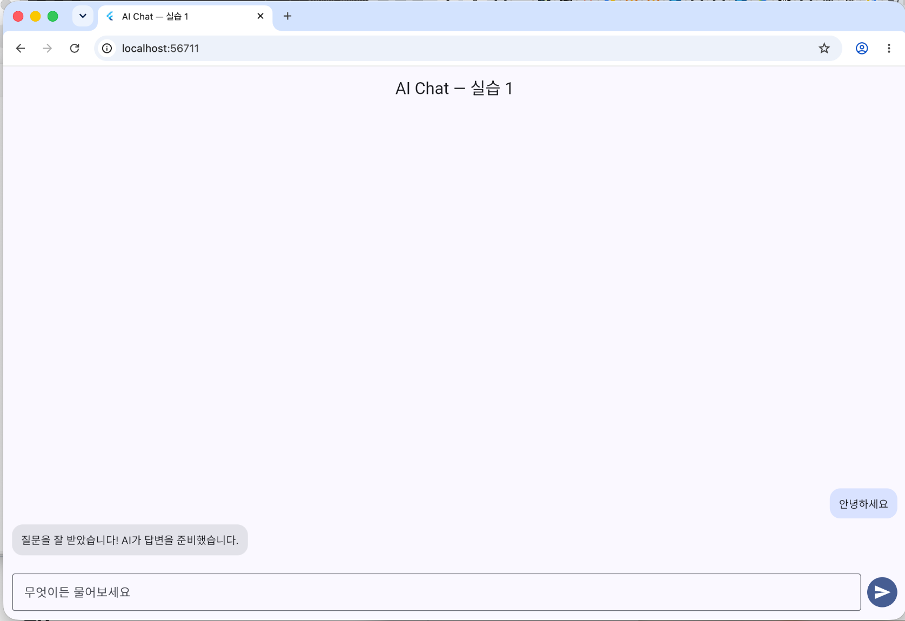
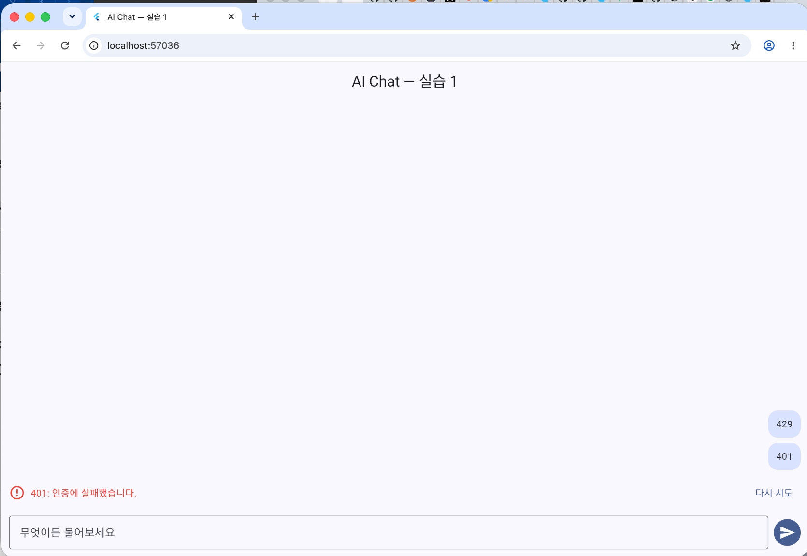
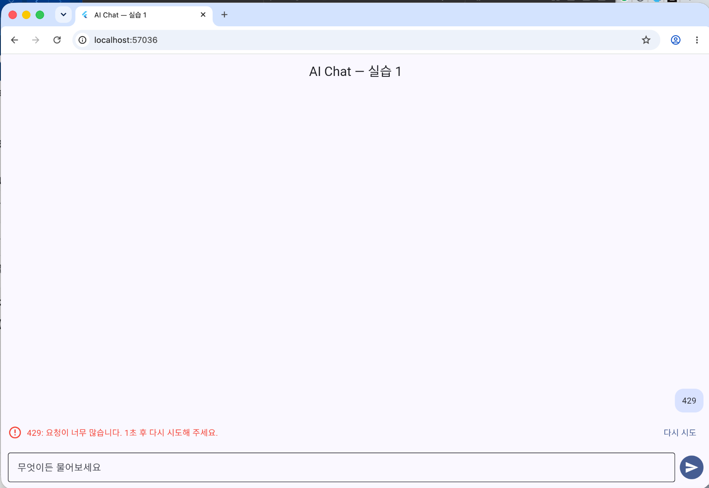
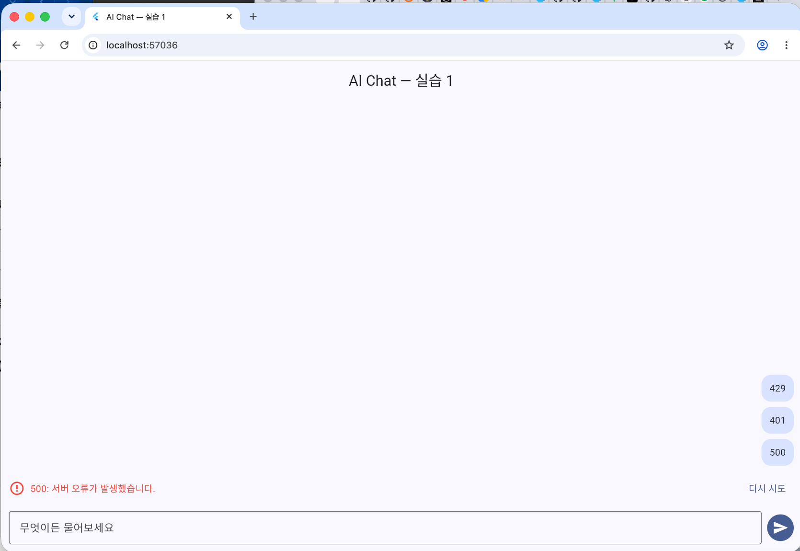
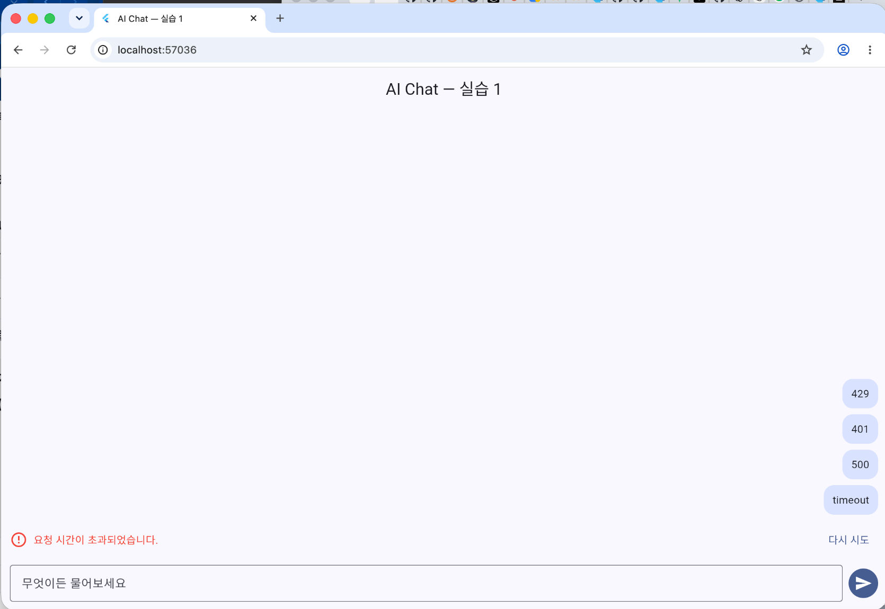

# 실습 1 — 채팅 UI (GAI3008-01 · 11주차)

> 목표: **보내고 받는 모양**을 먼저 만든다. API는 다음 실습에서 붙인다.
> 이 저장소는 **할 일 1번만 완성**되어 있고, 2~5번은 코드 안의 `TODO` 주석으로 안내한다.

## 실행

```bash
flutter pub get
flutter run -d chrome      # 또는 -d <에뮬레이터>
```

서버가 필요 없다. `_messages`에 들어 있는 가짜 대화로 화면만 만든다.

## 할 일

| # | 내용 | 상태 |
|---|---|---|
| 1 | `ListView.builder` + `reverse: true` — 최신이 아래 | ✅ **완성됨** |
| 2 | 말풍선 2종 — 사용자 오른쪽 / AI 왼쪽 | ⬜ `TODO 2` |
| 3 | 입력창 `TextField` + 전송 버튼 | ⬜ `TODO 3` |
| 4 | 빈 상태 — "무엇이든 물어보세요" | ⬜ `TODO 4` |
| 5 | 키보드가 입력창을 가리지 않게 | ⬜ `TODO 5` |

`lib/main.dart`에서 `TODO 2`~`TODO 5`를 검색하면 해당 위치로 바로 간다.

## 완료 기준 (수업 중 통과)

- 말풍선이 **좌우로** 나뉜다
- 입력창이 화면 **아래**에 붙어 있다
- 목록이 비면 **빈 상태 문구**가 보인다
- 키보드가 올라와도 입력창이 **가려지지 않는다**

## 힌트

- `reverse: true`면 index 0이 **화면 맨 아래**다. 그래서 `_messages[length - 1 - i]`로 꺼낸다.
- 색은 `Theme.of(context).colorScheme`에서 꺼내면 다크 모드에서도 안전하다.
- `TextEditingController`는 `dispose()`에서 정리한다.
- `ListView`를 `Stack`으로 감싸면 빈 상태를 위에 겹칠 수 있다.

## 구조

```
lib/main.dart          ← 실습 파일 (TODO 2~5)
test/widget_test.dart  ← 앱이 뜨는지 확인하는 스모크 테스트
```

## 제출

- 이 저장소를 `fork` → 브랜치 `feat/내이름-chat`
- 커밋 2개 이상, PR 1개
- PR 본문 3줄: 무엇 · 왜 · 시험

---

ⓒ 2026 Baryon Labs · 연세대학교 GAI3008-01 응용모바일프로그래밍 교육자료


---

## 11주차 실습 완료 기록

### 실습 1 — 채팅 UI

Flutter를 사용하여 채팅 화면을 구현했습니다.

- `ListView.builder`와 `reverse: true`를 이용한 메시지 목록
- 사용자와 AI의 말풍선을 좌우로 구분
- `TextField`와 전송 버튼 구현
- 채팅 기록이 없을 때 빈 상태 안내 문구 표시
- 입력창이 키보드에 가려지지 않도록 구성
- AI 응답 대기 중 점 세 개 애니메이션 표시

### 실습 4 — 오류와 재시도

실제 API 대신 모의 응답을 사용하여 오류 상황을 구현했습니다.

- `401`: 인증 오류
- `429`: 요청 횟수 초과
- `500`: 서버 오류
- `timeout`: 응답 시간 초과
- 오류 메시지 및 다시 시도 버튼 표시
- 재시도 시 사용자 말풍선 중복 생성 방지
- `AnimatedSwitcher`를 이용한 오류 상태 전환
- `429` 오류 시 대기 시간 1초 → 2초 적용

### 실행 화면


#### 실습 1 — 채팅 UI



#### 실습 4 — 오류 및 재시도

**401 인증 오류**



**429 요청 횟수 초과 및 재시도**



**500 서버 오류**



**Timeout 응답 시간 초과**


